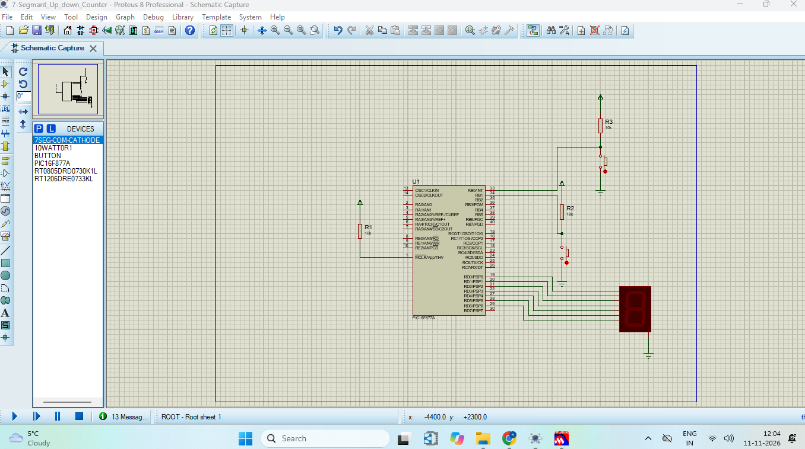
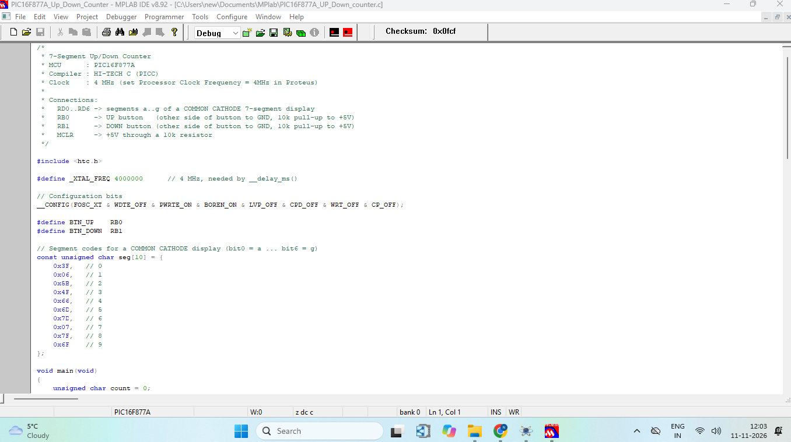
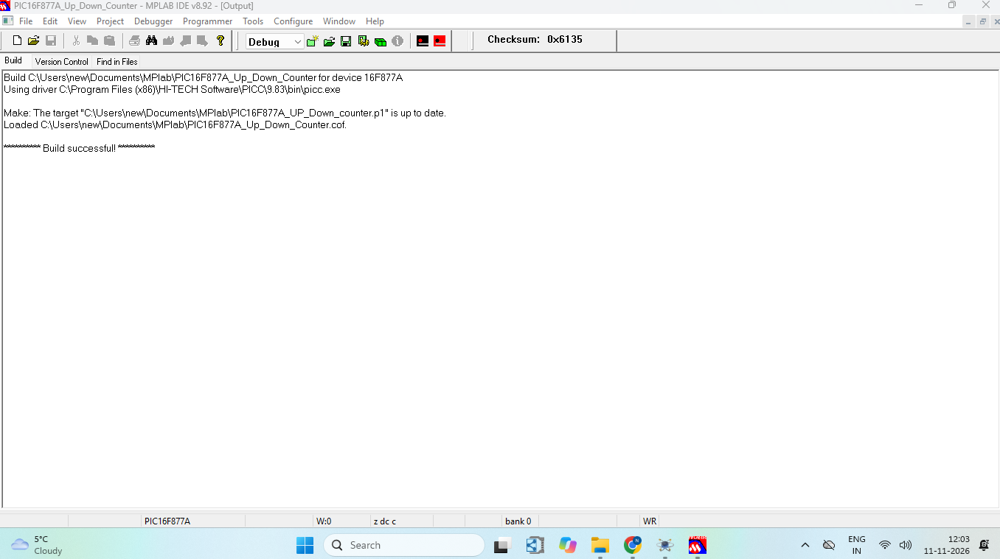
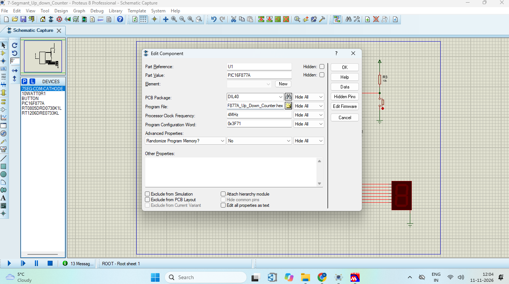
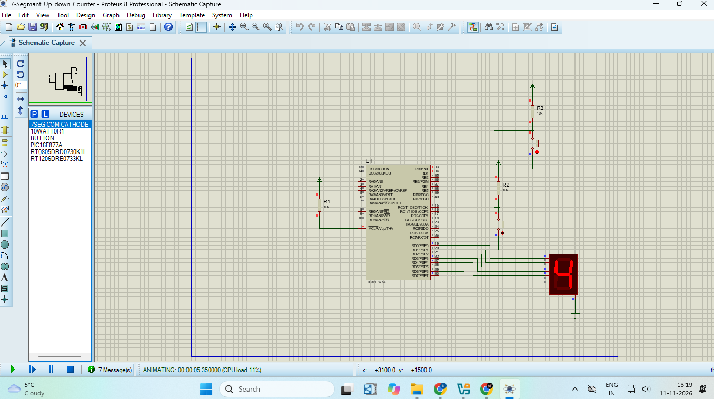

# PIC16F877A 7-Segment Up/Down Counter using HI-TECH C and Proteus


## Project Overview

This project is a **7-segment up/down counter** built around the **PIC16F877A** microcontroller. The code is written in **Embedded C**, compiled with the **HI-TECH C compiler (PICC 9.83)** inside **MPLAB IDE v8.92**, and simulated in **Proteus 8 Professional**.

Two push buttons control a single-digit display. Each press of the **UP** button adds 1 and each press of the **DOWN** button subtracts 1. The count wraps around: 9 goes to 0 on UP, and 0 goes to 9 on DOWN.

This was my first PIC project, and it covers the full workflow: writing the code, building the `.hex` file, loading it into the microcontroller in Proteus, and testing the result.

## Key Features

- Counts from 0 to 9 on a common cathode 7-segment display
- Separate UP and DOWN push buttons
- Automatic wrap-around at both ends (9 to 0 and 0 to 9)
- Software debouncing (30 ms) for reliable button presses
- One count per press, even if the button is held down
- Uses only 2.0% of the program memory of the PIC16F877A

## Components Required

| Component | Value | Quantity |
|-----------|-------|----------|
| PIC16F877A microcontroller (U1) | - | 1 |
| 7-segment display (common cathode) | 7SEG-COM-CATHODE | 1 |
| Push button | BUTTON | 2 |
| Resistor R1 (MCLR pull-up) | 10k | 1 |
| Resistors R2, R3 (button pull-ups) | 10k | 2 |
| Power and ground terminals | 5V | - |

> In Proteus the 7-segment display works without series resistors. On real hardware, add a 330 ohm resistor on each segment line.

### Circuit Diagram

The circuit is drawn in Proteus 8. Pins RD0 to RD6 drive the segments, and RB0 and RB1 read the buttons. MCLR is pulled up through R1.



### Pin Connections

| PIC Pin | Pin Name | Connected To |
|---------|----------|--------------|
| 1 | MCLR | VCC through R1 (10k) |
| 33 | RB0 | UP button, with a 10k pull-up to VCC |
| 34 | RB1 | DOWN button, with a 10k pull-up to VCC |
| 19 | RD0 | Display segment a |
| 20 | RD1 | Display segment b |
| 21 | RD2 | Display segment c |
| 22 | RD3 | Display segment d |
| 27 | RD4 | Display segment e |
| 28 | RD5 | Display segment f |
| 29 | RD6 | Display segment g |

The other end of each button goes to GND, and the COM pin of the display goes to GND.

## Source Code

The complete program is in the file `PIC16F877A.C`. A screenshot of the code in MPLAB IDE is shown below.



## Setup Process

### Step 1: Build the Code in MPLAB IDE

Create a project for the **PIC16F877A** with the **HI-TECH Universal ToolSuite**, add the source file, and click **Project → Build All**. The Output window should end with `Build successful!`. The build creates the HEX file `PIC16F877A_Up_Down_Counter.hex` in the project folder, which is loaded into the microcontroller in Proteus.



**Build result (HI-TECH C 9.83, Lite mode):**

| Memory | Used | Available | Percentage |
|--------|------|-----------|------------|
| Program space | 163 words | 8192 words | 2.0% |
| Data space | 5 bytes | 368 bytes | 1.4% |

### Step 2: Configure the PIC in Proteus

Double-click the PIC16F877A in Proteus and set:

| Property | Value |
|----------|-------|
| Program File | `PIC16F877A_Up_Down_Counter.hex` |
| Processor Clock Frequency | 4MHz |
| Program Configuration Word | 0x3F71 |



### Step 3: Run the Simulation

Click the **Play** button at the bottom left of Proteus. The display shows **0**. Click and hold the UP or DOWN button for a moment, then release, and the digit changes by one.

## Output

| Action | Display |
|--------|---------|
| Simulation starts | 0 |
| UP pressed | Count increases by 1 |
| UP pressed at 9 | Wraps to 0 |
| DOWN pressed | Count decreases by 1 |
| DOWN pressed at 0 | Wraps to 9 |

The picture below shows the simulation running, with the display showing the count 4.



**Demo video:** [Watch the demo](https://drive.google.com/file/d/1exH7erpBfEgbN_Tic3QwQRGQbwQItKnK/view?usp=drivesdk)

## How It Works

1. At start-up, PORTD is set as output for the segments, and PORTB is set as input for the buttons. The display shows 0.
2. The program checks the UP and DOWN buttons in an endless loop.
3. A pressed button pulls its pin LOW because of the pull-up resistor.
4. The program waits 30 ms and checks again. This debounce step ignores contact bounce.
5. The counter value is increased or decreased, and wraps around at 0 and 9.
6. The matching segment pattern from the `seg[]` table is sent to PORTD.
7. The program waits until the button is released, so each press counts only once.

```
Button press → debounce → update count → look up segment code → show on display
```

**Segment codes (common cathode):**

| Digit | Code | Digit | Code |
|-------|------|-------|------|
| 0 | 0x3F | 5 | 0x6D |
| 1 | 0x06 | 6 | 0x7D |
| 2 | 0x5B | 7 | 0x07 |
| 3 | 0x4F | 8 | 0x7F |
| 4 | 0x66 | 9 | 0x6F |

## How to Run

1. Install **MPLAB IDE v8.92** and the **HI-TECH C compiler (PICC 9.83)**.
2. Install **Proteus 8 Professional**.
3. Download or clone this repository.
4. Open `PIC16F877A.C` in MPLAB IDE, create a project for the PIC16F877A, and build it to create the HEX file.
5. In Proteus, draw the circuit shown in the Circuit Diagram section, using the pin connections table.
6. Double-click the PIC16F877A and set the Program File, clock frequency and configuration word as in Step 2.
7. Click **Play**, then click and hold the UP or DOWN button.

## Important Notes

### Display Type

The segment codes are for a **common cathode** display. For a common anode display, invert the codes (for example `~seg[count]`).

### Clock Frequency

The Processor Clock Frequency in Proteus must be **4MHz**, the same value as `_XTAL_FREQ` in the code. If the two values differ, the debounce delay will be the wrong length.

### Configuration Bits

The code sets the XT oscillator, watchdog timer off, power-up timer on, brown-out reset on, and low-voltage programming off. In Proteus, the Program Configuration Word 0x3F71 matches these settings.

### Clicking the Buttons

Click on the push button itself and hold the mouse button down for a moment. The small red or blue dots in Proteus only show the pin levels.

### Compiler Mode

The compiler ran in **Lite mode**, which makes the code slightly larger. This makes no difference for this program.

## Technologies and Concepts

- PIC16F877A microcontroller
- Embedded C with HI-TECH C (PICC)
- MPLAB IDE v8.92
- Proteus 8 circuit simulation
- GPIO input and output (TRIS registers)
- 7-segment display lookup table
- Push button debouncing
- Pull-up resistors

## Future Improvements

- Count from 00 to 99 using two 7-segment digits with multiplexing
- Add a RESET button to return the count to 0
- Auto-count mode with a timer and adjustable speed
- Build the circuit on real hardware and program the PIC with a PICkit
